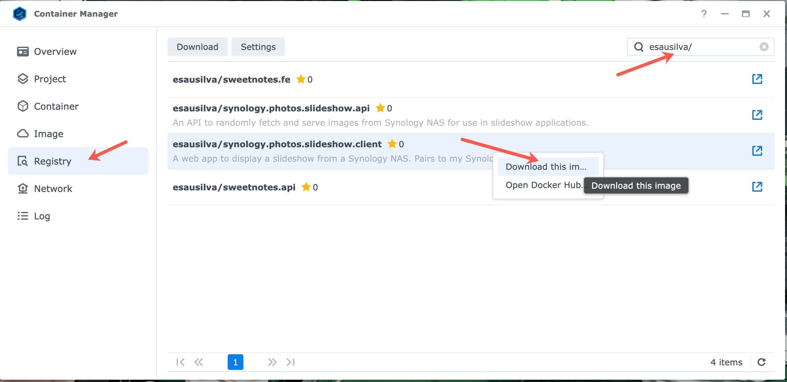
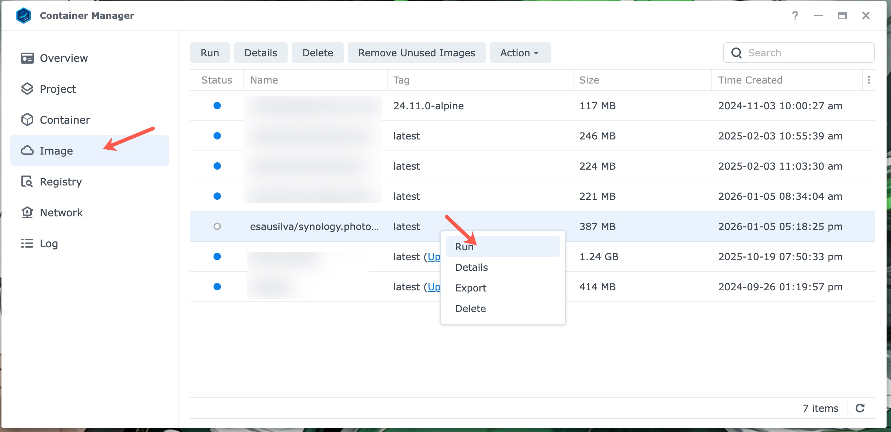

# Deployment To Your Synology NAS Device

## Docker Compose Project

Deploying via a Docker Compose Project is the recommended and simplest way to run the entire Synology Photos Slideshow suite (client, backend API, and Redis cache) on your Synology NAS. Synology Container Manager includes built-in support for **Projects**, allowing you to deploy and manage the full multi-container stack from a single configuration.

The `docker-compose.yaml` file, `.env.example` template, and complete setup instructions are maintained in the [Synology Photos Slideshow API](https://github.com/esausilva/synology-photos-slideshow-api) repository.

For the full step-by-step guide and environment variable reference, refer to the API deployment documentation:

👉 **[Deployment To Your Synology NAS Device](https://github.com/esausilva/synology-photos-slideshow-api/blob/main/docs/deployment-to-your-synology-nas-device.md#docker-compose-project)**

You can find the project configuration files directly in the API repository:
- [`docker-compose.yaml`](https://github.com/esausilva/synology-photos-slideshow-api/blob/main/deployment/docker-compose.yaml)
- [`.env.example`](https://github.com/esausilva/synology-photos-slideshow-api/blob/main/deployment/.env.example)

## Manual Setup via Container Manager GUI

Two options:

1. Download the latest image from my Docker Hub Repo: [esausilva/synology.photos.slideshow.client](https://hub.docker.com/r/esausilva/synology.photos.slideshow.client).
2. Build the image yourself and push it to your own Docker Hub repository. Following this route, you will need to rename the image to match your repository in the `docker-compose.yml` file. 

**For option 2:**

Run the following command to build the image:

```bash
docker-compose build
```

This will take the default docker compose file, `docker-compose.yaml`, and build the image, skipping the local docker compose file, `docker-compose.local.yml`.

Run the following command to push the image to your Docker Hub repository:

```bash
docker push [your-repo]/synology.photos.slideshow.client:latest
```

**For both options:**

From Synology Container Manager, click on the "Registry" tab and search for the appropriate repository and image.

Right-click on the image and select "Download this image".



Once the image is downloaded, you can create a container from it by going to the "Image" tab, then right-clicking on the image, and selecting "Run".



From there, you can configure the container. In the first screen you will need to set the container name, I would suggest checking-off the "Enable auto-restart" option.

On the second screen, configure the local (to the NAS) ports. Make sure you map the ports correctly to `3500:3000`. `3500` being the port on the NAS device, but you can choose whatever you want for this port.

Finally, you need to configure the environment variables under the "Environment" heading.

The environment variables will be as follows:

| **Environment Variable** | **Value**                 |
|--------------------------|---------------------------|
| SERVER__API_BASE_URL     | http://[YOUR-NAS-IP]:5097 |
| CLIENT__API_BASE_URL     | http://[YOUR-NAS-IP]:5097 |

Make sure you replace `[YOUR-NAS-IP]` with the IP address of your Synology NAS.

The slideshow will be available at `http://[YOUR-NAS-IP]:3500`.
